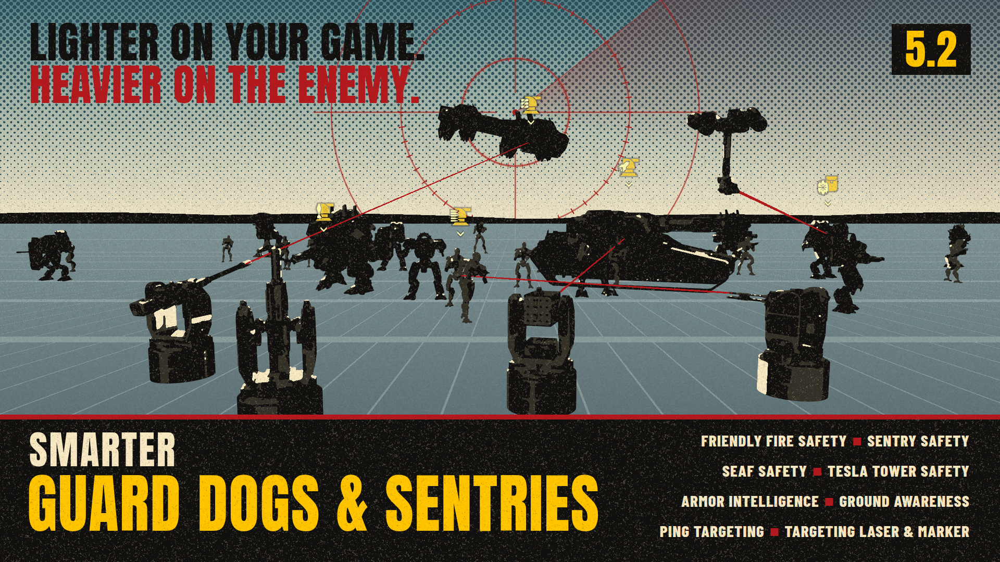

# Smarter Guard Dogs & Sentries
*Smarter, safer aiming for the Guard Dog, Rover and K-9, your sentries, and the guns on resupply pods and the Supply FRV.*

Smarter Guard Dogs & Sentries makes the shooting guard dog backpacks and your sentries aim the way you wish they did: they never shoot through you, your teammates, SEAF soldiers or other sentries, don't waste ammo, and go for the right target. New in 5.0: they read which part of a Hulk or Charger they're aiming at, your sentries go for the enemies you ping, and every dog and sentry shows its target with its own stratagem icon.

## Featured on YouTube
[SwanyPlaysGames - "Helldivers 2 Will NEVER Be the Same!"](https://youtu.be/55fwJxfNaDM?t=456) (the mod is shown from 7:36).

## New in 5.0
- **Part armor (Armor Intelligence):** your dogs and sentries look at the part of a Hulk or Charger they're aiming at and judge it by that part's armor, instead of skipping the whole enemy. A Hulk turned away shows its heatsink, a Charger its rear or underside, and the Machine Gun and Gatling sentries, the Rover and the Guard Dog fire on it; the armored front and plates are still left alone. When the part can't be worked out, the enemy is judged by its main armor as before.
- **Ping Targeting (new option):** your sentries go for an enemy you or a teammate ping: each sentry that can hurt it and has it in reach and in view turns to it first, for up to 20 seconds after the ping (the mortars fire on it wherever it is in their range). The safety rules still come first, and a ping waits while an enemy is at the sentry's feet or right next to a helldiver.
- **SEAF Safety (new option):** your guard dog and your sentries don't shoot through SEAF soldiers or civilians: they hold fire while one is in their line of fire, don't swing their fire across one, and the mortars, the Tesla Tower and the Rocket, Autocannon and Flame sentries leave alone enemies right next to one.
- **Targeting Marker (new option):** each dog and sentry shows its own stratagem icon over the enemy it's on, like a ping, only on your screen: yellow while it's on that enemy, gray when the enemy goes out of sight. Only on enemies it can hurt and has in reach. Several guns on one enemy show side by side, and the markers face you the same from the ground or from a rooftop. Marker Opacity sets how solid they are.
- **A new targeting laser:** the laser now runs along each gun's barrel like a mounted laser, so you see the angle it's firing from: red while it fires, flashing green when a friendly is in the way and the safety holds the shot. Glow is now the default; Line is still there.
- **Stalkers:** cloaked Stalkers and Predator Stalkers are no longer avoided as if they were behind cover (the Rover held off one closing in on you).
- **Closer threats first for the dog:** an enemy close to you is no longer set aside because the safety held the dog's shot, and the dog's marker stays on its target the whole time it has one.

## Guard dog features
- **Never shoots through you or your teammates:** it looks ahead when you spin around, and fires again the moment you're out of its way. The Safety option chooses who it protects: you and your teammates, only you, or only your teammates. The K-9 also avoids arcs that would chain back to you or a teammate. SEAF Safety covers SEAF soldiers and civilians too.
- **Closest threat first, without the hesitation (Target Prioritization):** the Guard Dog and K-9 get a burst off before they're pulled to the next closer enemy, then catch up.
- **No shooting the dead:** it moves on the moment its target dies, and stops firing at the spot the moment its target is lost.
- **Engages at once:** the moment an enemy it can shoot comes into view, it picks it and opens fire instead of waiting on the game's own re-pick timer.
- **No wasted aiming:** it stops firing the moment its target ducks behind cover, doesn't pick enemies it can't see, and gives up on an enemy it keeps lining up without getting a shot (quickly for far ones, only briefly for ones close to you).
- **Skips armor it can't hurt (Armor Intelligence):** the Guard Dog leaves Tanks, emplacements, bunker turrets and other Heavy armor alone, and fires on Hulks and Chargers only where it can hurt them (a Hulk's heatsink, a Charger's rear). It fires only short suppressing bursts at Heavy Devastators. The Guard Dog and Rover also leave the guns on Factory Striders and Vox Engines alone. The Rover also leaves Scout Striders alone but still burns Devastators' legs. The K-9 skips nothing.
- **Range:** the Guard Dog ignores enemies beyond its reach (about 32 m), and the Rover sticks to enemies within 35 m while any are around. It's a guard dog: the enemies near you come first.
- **The Rover spreads its fire:** lighting the closest unlit enemies first, with about half a second of beam on each.

## Sentry features
- **Never fires through you or your teammates:** every sentry holds fire while you're in its line of fire (also while you pilot an exosuit), and the Machine Gun, Gatling, Laser and Flame sentries won't swing their fire across you while turning to the next target. The Autocannon and Rocket sentries won't fire at an enemy close enough to you to catch you in the blast, and the Mortar and EMS Mortar sentries won't shell enemies next to you.
- **Never fires through SEAF soldiers or civilians (SEAF Safety):** the same care for the SEAF soldiers and civilians fighting alongside you.
- **Never fires through other sentries (Sentry Safety):** your sentries hold fire while another sentry, yours or a teammate's, is in their line of fire, and don't swing their fire across one. The Rocket, Autocannon and Flame sentries won't fire at an enemy right next to a sentry, and the Mortar won't shell enemies within 7 m of one. (The Tesla Tower's arc doesn't hurt sentries.)
- **Goes for your pings (Ping Targeting):** a sentry that can hurt the enemy you or a teammate pinged, and has it in reach and in view, turns to it first.
- **No firing into walls:** a sentry drops a target that went behind cover and picks one it can hit.
- **No shooting the dead:** a sentry moves on the moment its target dies, and stops firing at the spot the moment its target is lost (the game kept it shooting where it was for about a second).
- **Self-defense first (Target Prioritization):** an enemy right at the sentry that it can hurt is dealt with before anything else, so the sentry isn't wrecked while it chases a better target.
- **Gunships first (Target Prioritization):** the Gatling, Autocannon, Rocket and Laser sentries go for Gunships (and Stingrays on Illuminate missions) before anything else.
- **The right target for the gun (Target Prioritization):** the Rocket and Autocannon sentries go for Heavy armor first; the Machine Gun, Gatling and Laser sentries go for everything lighter first. An enemy right next to you always stays the target.
- **Skips what it can't hurt (Armor Intelligence):** the Machine Gun and Gatling sentries skip Tanks and other Heavy armor, fire on Hulks and Chargers only where they can hurt them (a Hulk's heatsink, a Charger's rear or underside), and fire short bursts at Heavy Devastators; the Laser Sentry skips anything above Heavy. No sentry wastes ammo on dropships, and only the Rocket and Autocannon sentries (whose blast also hurts the dropship) shoot enemies still aboard one.
- **Flame Sentry:** engages enemies its flames can reach (30 m), not ones well out of range, and goes for the closest first, so an enemy closing in comes before one farther out (Target Prioritization). Once an enemy is on fire it moves on to the next unlit one, closer ones first, but never leaves a burning enemy next to you.
- **Laser Sentry:** sets enemies alight with about half a second of beam and moves on to the next one, like the Rover, but keeps firing at burning enemies within 15 m of you or itself, never sits idle while enemies are in reach, and stays on Chargers, Bile Titans and other heavy armor until they're dead. It cools down before it burns out (it reads the game's own heat meter and runs between 90% and 70% heat).
- **Tesla Tower:** it no longer zaps you or your teammates when you stand in its range: the mod keeps helldivers off its list of targets. It also leaves enemies within 10 m of a helldiver (or a SEAF soldier) alone so its arc doesn't chain into them.
- **Armed Resupply Pod and Supply FRV guns:** the guns on Armed Resupply Pods and the M-103 Supply FRV get the same care as the Machine Gun Sentry: safety, armor skipping and the right targets. The FRV gun never stops for riders sitting in the FRV, only for anyone leaning out of a window to shoot. Both guns turn to an enemy far off to the side before firing instead of spraying on the way, and the FRV gun stops firing the moment its last enemy is gone.
- **Works with Sentry Aim Retention and Laser Sentry Cooldown.**

## Targeting laser and markers
Shown only on your screen, for your dog and your sentries (not the mortars, which fire over cover).
- **Targeting Laser:** a beam out of each gun's barrel along where it's really pointing, like a mounted laser, so you can see the angle it's firing from: red while it fires, flashing green when a friendly is in the way and the safety holds the shot, off while the dog reloads. The Tesla Tower shows its 20 m reach as a red ring, lit the whole time it's out, and a red ring flashes around the Rocket Sentry while an enemy is too close for it to fire. *Glow* (the default): a soft glowing beam with a bright spot on the target; it shows through walls and objects, like the markers. *Line*: a thin line with a small cross where it hits; walls and objects hide it.
- **Laser Brightness:** Dim (50%), Softer (75%), Normal, Bright (150%) or Brightest (200%), for the beams and rings.
- **Targeting Marker:** each gun's own stratagem icon over the enemy it's on, like a ping: yellow while it's on that enemy, gray when the enemy goes out of sight (cover or smoke). Only on enemies it can hurt and has in reach; several guns on one enemy show side by side; it faces you from any angle and shows through walls. Works with or without the laser.
- **Marker Opacity:** Full (100%), Medium (75%), Light (50%) or Faint (25%).

Only your own dog and sentries are affected (the Safety option also protects the other players from them). Works hosting or joining, finds what it needs again after game patches, and is light on your PC. Hot Dog and Dog Breath are not changed.

## Options (Arsenal / HD2 Mod Manager)
- **Smarter Guard Dogs and Sentries** - the core. Keep this on.
- **Guard Dogs** - turn off to leave your guard dog to the game.
- **Sentries** - your sentries and the guns on resupply pods and the Supply FRV. Choose *All sentries* or *All but the Tesla Tower*, or turn off to leave them to the game.
- **Intelligence** - choose *Armor Intelligence and Target Prioritization*, *Only Armor Intelligence* or *Only Target Prioritization*, or turn off to leave both to the game. Armor Intelligence: skipping armor (or the part of a Hulk or Charger) they can't hurt, short bursts at Heavy Devastators and skipping dropships. Target Prioritization: the closest threat first for the dogs; self-defense, Gunships and the armor that suits the gun first for the sentries (the closest first for the Flame Sentry).
- **Ping Targeting** - new in 5.0: your sentries go for the enemies you and your teammates ping. On by default.
- **Safety** - choose who they never fire through: *You and your teammates*, *Only you* or *Only your teammates*. Turn off at your own risk.
- **Sentry Safety** - your sentries don't fire through other sentries, yours or your teammates'. On by default.
- **SEAF Safety** - new in 5.0: your dog and your sentries don't fire through SEAF soldiers or civilians. On by default.
- **Targeting Laser** - choose *Glow* (the default) or *Line*, or turn off to hide the laser.
- **Laser Brightness** - choose *Normal (100%)* (the default), *Dim (50%)*, *Softer (75%)*, *Bright (150%)* or *Brightest (200%)*.
- **Targeting Marker** - new in 5.0: each gun's icon over its target. On by default; turn off to hide the markers.
- **Marker Opacity** - new in 5.0: choose *Full (100%)* (the default), *Medium (75%)*, *Light (50%)* or *Faint (25%)*.
**In game:** with [Mod Options Menu](https://github.com/CowboyBingus/ModOptionsMenu) installed, every option is also under ESC > MODS > SMARTER GUARD DOGS & SENTRIES, laid out as in the mod manager, and a change takes effect the moment you apply it. The options picked in the mod manager are the starting values.

## Requirements
[Bingus Shared Loader](https://www.nexusmods.com/helldivers2/mods/16292) v19 or newer, last in the load order.

## Download
Get the latest zip from the [Releases](../../releases/latest) page (the `Smarter-Guard-Dogs-and-Sentries-<version>.zip` file, not the source code).

## Install / update
1. Install Bingus Shared Loader v19 or newer.
2. Remove any older version of Smarter Guard Dogs (& Sentries).
3. Add Smarter-Guard-Dogs-and-Sentries-5.0.0.zip in Arsenal or the HD2 Mod Manager and check the options you want (updating: make sure the new Ping Targeting, SEAF Safety, Targeting Marker and Marker Opacity options are checked).
4. Purge, then Deploy (always both, every time you install or update), then restart the game.

## Uninstall
Remove it in your mod manager, then Purge and Deploy. Nothing is left behind in the game.

## Compatibility
- Works alongside Sentry Aim Retention.
- Works alongside Laser Sentry Cooldown (CowboyBingus): an overheated Laser Sentry cools down and comes back, and this mod still cools it before it overheats.
- Supports Mod Options Menu (optional).
- Don't combine it with other mods that change guard dog or sentry targeting (for example Laser Rover Targeting Optimization).
- Made and tested on the October 2026 game version: the Rover, Guard Dog and K-9 and every sentry, against Terminids, Automatons and Illuminate, solo and in multiplayer.

## Known limitations
- The game still decides when to shoot. The dog may hold fire on enemies that haven't engaged you yet.
- Brief pauses when you step into the line of fire, by design.
- Line of sight updates about twice a second, so a dog or sentry may briefly fire at cover or hesitate as enemies duck in and out of view.
- Rarely, a sentry may fire into a rise or a wall when an enemy is just behind it.
- Part armor covers Hulks and Chargers; every other enemy is still judged by its main armor.
- Sentries sometimes finish a salvo or burst on their old target before switching, and the Autocannon and Rocket sentries may fire at the spot for up to a second after a kill (stopping that would cut their salvos short).
- The Tesla Tower can't be stopped once it has started a zap, so a helldiver who steps into its path at that moment can still be hit. Going prone still keeps you safe, as in the base game.
- The Glow laser and the markers show through walls and objects (the game draws them on top of the world). Choose Line for a beam that walls hide.
- The Rocket Sentry can't fire while an enemy is within about 10 m of it (the game's rule); a red ring flashes around it then.
- Teammates' sentries run on their own game and aren't changed (yours still won't fire through them).
- Teammates piloting an exosuit aren't protected yet (you are).
- Safety for teammates may briefly hold fire near a teammate's body right after they reinforce.
- A major game update may switch the mod off until it's updated.

## How it works
**It doesn't alter any game data.** No game files, weapon stats, damage, range or enemy values are changed, unlike mods that rework those. It's a Lua addon that filters your dog's and sentries' choice of target while you play: the game's own targeting stays in charge, and the mod only hides the enemies they shouldn't shoot from their list and asks them to pick again (and keeps helldivers off the Tesla Tower's list of targets). No DLLs are added, no game code is patched, and everything is put back when it's not needed.

## Troubleshooting
Attach SmarterGuardDogsAndSentries.log to your bug report. You'll find it in %LOCALAPPDATA%\CowboyBingus\Helldivers2\Logs, next to the other Bingus mods' logs (paste that into the File Explorer address bar and press Enter). It lists what the mod did, how long each dog and sentry was out and how much of that time it had a target, and any errors.

## Support

All my mods are free and always will be. Every release is rigorously tested in real missions, highly optimized and kept working through game updates. If you'd like to help me keep that up and build new mods, you can support me on [Patreon](https://www.patreon.com/c/Chefboiardee).

Thank you for diving with me!

## Credits

- **CowboyBingus** - Bingus Shared Loader.
- Armor values: Helldivers Wiki.

## Building from source
The mod is plain Lua: `src/build.py` (Python 3, no extra packages) joins the `engine_*.lua` parts into one script, packs it and the option add-ons into Helldivers 2 patch archives, and writes the Arsenal / HD2 Mod Manager zip to `src/build/`.

```
cd src
python build.py
```

The zip it makes is the same one attached to each release. `python build.py tester` also builds a Tester zip with extra logging for bug hunting.

## Changelog
See [CHANGELOG.md](CHANGELOG.md).

## License
Copyright (c) 2026 Th3chef. All rights reserved. You're welcome to read the source, report bugs and suggest fixes, but please ask before reusing it or reuploading the mod. See [LICENSE](LICENSE).
